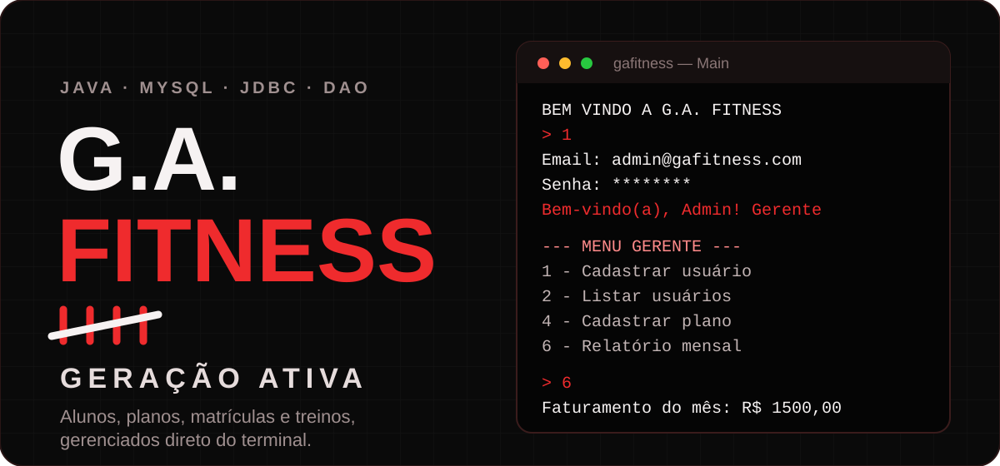
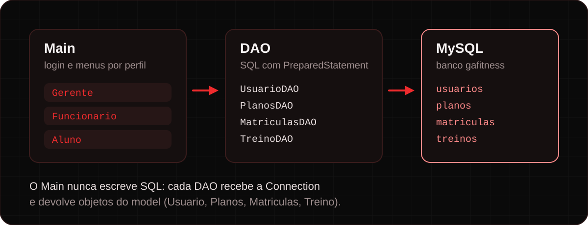
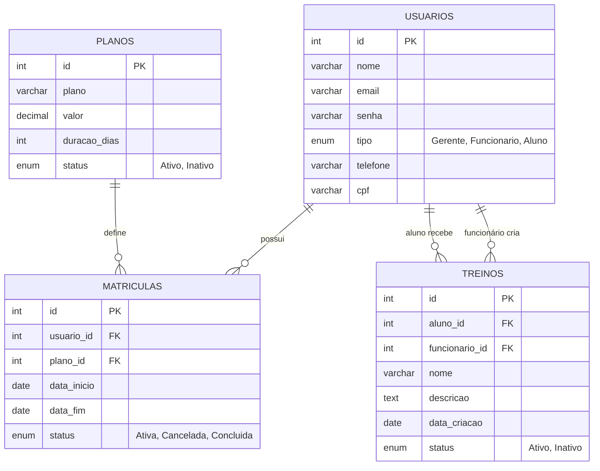

<p align="center">
  
</p>

<p align="center">
  <a href="#como-funciona">Como funciona</a> ·
  <a href="#perfis">Perfis</a> ·
  <a href="#banco-de-dados">Banco de dados</a> ·
  <a href="#rodando-o-projeto">Rodando o projeto</a> ·
  <a href="#documentação">Documentação</a> ·
  <a href="#o-que-falta">O que falta</a>
</p>

---

## O que é

O **G.A. Fitness** organiza o dia a dia de uma academia: usuários, planos, matrículas e treinos ficam em um banco **MySQL** e são acessados por um programa de terminal em **Java**. Depois do login, cada pessoa vê apenas o menu do seu perfil.

É o trabalho de conclusão de semestre do grupo, escrito com **JDBC** e o padrão **DAO**.

## Perfis

| Perfil | O que faz |
|:--|:--|
| **Gerente** | Cadastra e lista usuários, consulta por CPF, cadastra planos, lista matrículas, gera o relatório mensal e lista treinos |
| **Funcionário** | Lista os treinos |
| **Aluno** | Vê apenas os próprios treinos |

## Como funciona

<p align="center">
  
</p>

- **`Main`** pede e-mail e senha, chama `usuarioDAO.login(...)` e abre o menu conforme o `tipo` do usuário.
- **`dao/`** concentra todo o SQL, sempre com `PreparedStatement`.
- **`model/`** guarda os dados (`Usuario`, `Planos`, `Matriculas`, `Treino`).

```text
conexao/   ConexaoDB.java · Tabela.java
model/     Usuario.java · Planos.java · Matriculas.java · Treino.java
dao/       UsuarioDAO.java · PlanosDAO.java · MatriculasDAO.java · TreinoDAO.java
docs/      Documentacao_GA_Fitness.docx
Main.java
```

## Banco de dados

<details>
<summary>Ver o diagrama das tabelas</summary>



</details>

## Rodando o projeto

**Precisa de:** JDK 17+, MySQL 8 em execução e o `mysql-connector-j` (`.jar`) nas bibliotecas do projeto.

**1. Crie o banco**

```sql
CREATE DATABASE gafitness;
```

**2. Configure a conexão** em `ConexaoDB.java`

```java
public static final String URL_JDBC = "jdbc:mysql://localhost:3306/gafitness?allowMultiQueries=true";
public static final String user  = "seu_usuario";
public static final String senha = "sua_senha";
```

> Não suba a sua senha real do MySQL para o GitHub.

**3. Crie as tabelas:** execute `Tabela.java` uma vez. A saída esperada é `Tabelas Criadas com Sucesso`.

**4. Crie o primeiro Gerente.** Só um Gerente cadastra os outros usuários, então o primeiro entra direto pelo banco:

```sql
USE gafitness;
INSERT INTO usuarios (nome, email, senha, tipo, telefone, cpf)
VALUES ('Admin', 'admin@gafitness.com', 'admin123', 'Gerente', '11999999999', '000.000.000-00');
```

**5. Execute `Main.java`** e entre com `admin@gafitness.com` / `admin123`.

<details>
<summary>Deu erro? Problemas comuns</summary>

| Erro | Solução |
|:--|:--|
| `No suitable driver found` | Adicione o `mysql-connector-j` ao projeto |
| `NullPointerException` ao conectar | A conexão falhou: confira URL, usuário, senha e se o MySQL está ligado |
| `Unknown database 'gafitness'` | Rode `CREATE DATABASE gafitness;` |
| `Table already exists` | Apague as tabelas ou use `CREATE TABLE IF NOT EXISTS` |
| `Non-static method ... static context` | Chame pelo objeto: `usuarioDAO.login(email, senha)` |

</details>

## Documentação

O projeto tem uma documentação completa em Word, feita pelo grupo: `docs/Documentacao_GA_Fitness.docx` *(troque pelo nome real do arquivo)*. Ela cobre requisitos, modelagem, arquitetura, testes e conclusão.

## O que falta

- [ ] Matricular aluno em um plano
- [ ] Criar e editar treinos
- [ ] Alterar senha pelo menu
- [ ] Guardar senhas com hash em vez de texto puro
- [ ] Página HTML/CSS que simula o terminal
